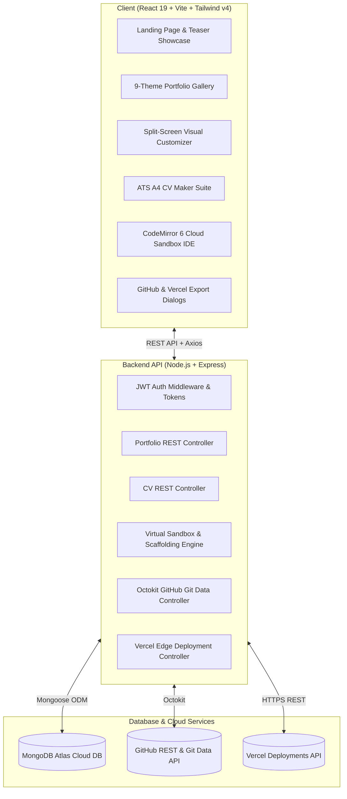

<div align="center">

# ⚡ Forged

**The Developer Portfolio & CV Platform**

*Craft stunning developer portfolios, ATS-optimized CVs, and production-ready Next.js repositories in minutes.*

[](https://react.dev/)
[](https://vitejs.dev/)
[](https://tailwindcss.com/)
[](https://nodejs.org/)
[](https://expressjs.com/)
[](https://www.mongodb.com/atlas)
[](https://codemirror.net/)
[](LICENSE)

</div>

---

## 📖 Overview

**Forged** is a full-stack developer portfolio and career platform modeled for modern software engineers. It replaces clunky CMS builders with a developer-first suite of tools:

1. **9 Production Portfolio Themes**: Scoped CSS modules, zero styling leakage, distinct engineering identities (from Cyberpunk to Swiss Minimal).
2. **Split-Screen Real-Time Customizer**: Keystroke-instant live previews, draggable divider, device viewport toggles, and MongoDB Atlas autosaving.
3. **ATS-Optimized A4 CV Maker**: Recruiter-approved single-page layout, one-click synchronization with portfolio data, and pixel-perfect `@media print` PDF export.
4. **In-Browser Cloud Sandbox IDE**: CodeMirror 6 with syntax highlighting (JSX/TSX/CSS/JSON), multi-tab file explorer, hot reload preview, and simulated build terminal logs.
5. **One-Click Deployments**: Direct GitHub repository export via Git Data API (atomic multi-file commits), Vercel production edge deployment, and offline ZIP packaging.

---

## 🏗️ System Architecture



---

## ✨ Features

### 1. 9 Handcrafted Live Portfolio Themes
Every template is self-contained with its own scoped CSS module to prevent style collisions:

| # | Theme | Aesthetic & Identity | Tech Focus |
|---|---|---|---|
| **1** | **Brutalist** | High-density grid, monospace typography, architectural borders | Full-Stack & Systems Engineers |
| **2** | **Cyberpunk** | High-contrast neon cyan & emerald, HUD scanlines, dark tech glow | Security, Web3 & Game Developers |
| **3** | **Designer** | Editorial serif headlines, airy card grids, visual showcase | Frontend & Product Designers |
| **4** | **Minimal** | Ultra-clean monochrome typography, Swiss alignment, distraction-free | Senior Engineers & Researchers |
| **5** | **Creative** | Frosted glassmorphism, vibrant badges, playful interactive cards | Mobile & Creative Technologists |
| **6** | **Professional** | Enterprise executive styling, career timeline, recruiter focus | Staff/Lead Engineers & Architects |
| **7** | **Terminal** | Interactive bash CLI, phosphor green glow, command history | DevOps & Linux Infrastructure |
| **8** | **Bold** | High-impact black & white typography, punchy startup feel | Founders & Indie Hackers |
| **9** | **Luxury** | Deep obsidian backdrop with warm champagne gold accents | Executives, CTOs & Consultants |

### 2. Live Split-Screen Customizer (`/studio/templates/:templateId`)
- **Drag-to-Resize Splitter**: Adjust form vs. preview pane to any screen ratio.
- **Device Viewports**: Preview across Desktop (100%), Tablet (768px), and Mobile (375px) in an interactive mock browser chrome.
- **Zero-Lag Typing**: Debounced updates instantly re-render the selected template.
- **Cloud Autosave**: Persists configuration to MongoDB Atlas in the background with visual sync indicators.

### 3. A4 ATS-Friendly CV Maker (`/studio/cv-maker`)
- Standard **210mm × 297mm (A4)** print layout with ATS-safe semantic HTML headings and tables.
- **Sync with Portfolio**: Automatically imports your name, title, bio, experience, projects, and skills from any saved portfolio.
- **Print & PDF Export**: Native `@media print` styling removes browser chrome and exports clean, high-resolution single-page PDFs.

### 4. In-Browser CodeMirror 6 IDE (`/editor`)
- **File Explorer**: Tree view supporting file/folder creation, renaming, and deletion.
- **CodeMirror 6 Engine**: Syntax highlighting for JSX, TSX, CSS, JSON, and HTML with `oneDark` theme and bracket matching.
- **Virtual Filesystem**: Self-contained runtime generating standalone Next.js 15 project structures with zero external container dependencies.
- **Live Execution Preview**: Dynamic in-browser component preview updating live as code or data changes.
- **Simulated Terminal**: Collapsible build log drawer displaying Next.js compilation timings.

### 5. Automated GitHub & Vercel Integrations
- **GitHub Export**: Connects via Personal Access Token or stored account to create a new repo and push all project files via GitHub's Git Data API in a single atomic commit.
- **Vercel Deploy**: Bundles files inline and triggers a serverless edge deployment with a 3-stage live build progress tracker (*Uploaded* $\rightarrow$ *Building* $\rightarrow$ *Live*).
- **Download Project ZIP**: Client-side fallback using JSZip to download the full, production-ready Next.js project archive offline.

---

## 📁 Repository Structure

```
CMS/
├── client/                     # Frontend Application (React 19 + Vite)
│   ├── src/
│   │   ├── components/
│   │   │   ├── cv/             # A4 CV Form & Print Preview components
│   │   │   ├── dialogs/        # GitHubUploadDialog & VercelDeployDialog
│   │   │   ├── editor/         # CodeEditor, FileTree, FileTabs, EditorPreview
│   │   │   ├── landing/        # Hero, Showcase, Navbar, CTA, Testimonials
│   │   │   └── studio/         # AppSidebar, BrowserPreview, TemplateCard
│   │   ├── context/            # AuthContext, ThemeContext, ToastContext
│   │   ├── layouts/            # StudioLayout (collapsible dashboard shell)
│   │   ├── lib/                # Default portfolio data, template registry
│   │   ├── pages/              # Landing, Studio, Editor, Auth, NotFound
│   │   └── portfolio-templates/# 9 Scoped templates (Portfolio1 to Portfolio9)
│   ├── vite.config.js          # Code splitting, API proxies & asset pipeline
│   └── package.json
│
├── server/                     # Backend API (Node.js + Express)
│   ├── controllers/
│   │   ├── authController.js   # User registration & JWT authentication
│   │   ├── portfolioController.js # Portfolio CRUD & MongoDB Atlas sync
│   │   ├── cvController.js     # CV maker CRUD & synchronization
│   │   ├── sandboxController.js# In-memory virtual sandbox & filesystems
│   │   ├── githubController.js # Octokit repo creation & atomic tree commits
│   │   └── vercelController.js # Vercel REST API deployment & status polling
│   ├── models/                 # Mongoose schemas (User, Portfolio, Cv)
│   ├── routes/                 # Express API routes
│   ├── middleware/             # JWT auth & optional token protection
│   ├── utils/                  # Standalone Next.js project scaffold generator
│   └── index.js                # Server entry point
│
└── README.md
```

---

## 🚀 Getting Started

### Prerequisites
- **Node.js**: v18.0.0 or higher
- **npm** or **pnpm**
- **MongoDB Atlas** database URI

### 1. Clone & Setup Backend

```bash
cd server
npm install
```

Create a `.env` file in `server/` (see `server/.env.example`):

```env
PORT=5001
MONGO_URI=mongodb+srv://<user>:<password>@cluster0.mongodb.net/forged_db?retryWrites=true&w=majority
JWT_SECRET=your_jwt_secret_key_here
NODE_ENV=development

# Optional Integrations
GITHUB_TOKEN=ghp_your_personal_access_token_with_repo_scope
VERCEL_TOKEN=your_vercel_api_token
```

Start the backend server:

```bash
npm run dev
# Server running on http://localhost:5001
```

### 2. Setup Frontend

```bash
cd ../client
npm install
```

Create a `.env` file in `client/` (see `client/.env.example`):

```env
VITE_API_URL=http://localhost:5001
```

Start the Vite development server:

```bash
npm run dev
# Client running on http://localhost:3001
```

### 3. Verify Production Build

```bash
cd client
npm run build
```

---

## 📡 API Reference

### Portfolios (`/api/portfolio`)
| Method | Endpoint | Description | Auth |
|---|---|---|---|
| `GET` | `/api/portfolio` | Get user portfolios or query by `?templateId=1` | Required |
| `GET` | `/api/portfolio/:id` | Get portfolio details by MongoDB ID | Required |
| `POST` | `/api/portfolio` | Upsert portfolio configuration & content | Required |
| `DELETE`| `/api/portfolio/:id` | Delete portfolio | Required |

### CV Maker (`/api/cv`)
| Method | Endpoint | Description | Auth |
|---|---|---|---|
| `GET` | `/api/cv` | Fetch user's saved CV document | Required |
| `POST` | `/api/cv` | Save or update CV document | Required |

### Cloud Sandbox (`/api/sandbox`)
| Method | Endpoint | Description | Auth |
|---|---|---|---|
| `POST` | `/api/sandbox/create` | Allocate a new sandbox session | Optional |
| `POST` | `/api/sandbox/deploy-template` | Scaffold template files into sandbox | Optional |
| `GET` | `/api/sandbox/files` | List directory contents | Optional |
| `GET` | `/api/sandbox/files/read` | Read file source code | Optional |
| `POST` | `/api/sandbox/files/write` | Write or update file code | Optional |
| `POST` | `/api/sandbox/files/mkdir` | Create folder | Optional |
| `POST` | `/api/sandbox/files/delete` | Delete file or directory | Optional |
| `POST` | `/api/sandbox/extract-data` | Extract JSON props from `page.tsx` | Optional |
| `POST` | `/api/sandbox/kill` | Terminate sandbox session | Optional |

### Deployments (`/api/github` & `/api/vercel`)
| Method | Endpoint | Description | Auth |
|---|---|---|---|
| `POST` | `/api/github/upload` | Push standalone project to new GitHub repo | Optional |
| `GET` | `/api/github/status` | Check if GitHub token is configured | Optional |
| `POST` | `/api/github/token` | Save GitHub token to user profile | Optional |
| `POST` | `/api/vercel/deploy` | Create production deployment on Vercel | Optional |
| `GET` | `/api/vercel/status` | Poll deployment build status | Optional |
| `POST` | `/api/vercel/token` | Save Vercel token to user profile | Optional |

---

## 💡 Engineering Highlights & Technical Decisions

1. **Scoped CSS Isolation without Runtime Overhead**: Rather than relying on heavyweight shadow DOMs or iframe sandboxes for every gallery card, each template uses scoped CSS Modules with strict class names. This allows rendering all 9 templates concurrently in gallery previews and customizers with zero style pollution.
2. **Virtual Filesystem Sandbox**: Avoids hard dependencies on paid third-party cloud container tiers for local evaluations. The in-memory virtual filesystem enables fast file operations, directory nesting, and AST data extraction out-of-the-box, with optional cloud container bridge support when credentials are provided.
3. **Route-Level Code Splitting**: Resolved esbuild memory exhaustion limits on resource-constrained systems by implementing dynamic imports for CodeMirror, GrapesJS, and JSZip. The production bundle is chunked cleanly into independent lazy-loaded packages.
4. **Git Data API Atomic Commits**: Rather than making individual commits per file or using local Git clones, GitHub repository exports create blobs in parallel, assemble a Git tree, and push an atomic commit directly to `heads/main`.

---

## 📄 License

Distributed under the MIT License. See [LICENSE](LICENSE) for more information.

<div align="center">
  <sub>Forged &copy; 2026. Crafted for developers.</sub>
</div>

